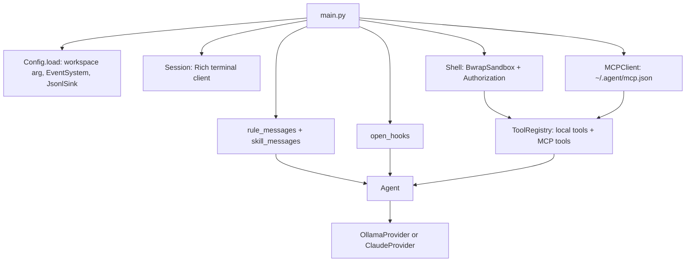

# Architecture

How a turn moves from the terminal through the agent loop to a provider and
back. The harness mechanisms that feed the context are in
[harness.md](harness.md); tools are in [tools.md](tools.md).

## Startup

`main.py` wires every collaborator once and then loops on user input.

1. `load_dotenv` reads `.env` next to `main.py`; existing variables win.
2. `Config.load` parses the optional `workspace` argument (default `.`,
   resolved, must be a directory), creates the `EventSystem`, and subscribes
   the JSONL sink. See [events-and-logs.md](events-and-logs.md).
3. `Session` subscribes to `provider.delta` to paint streaming output.
4. `Shell` gets a `BwrapSandbox` bound to the workspace and an `Authorization`
   that prompts through `Session.ask_elevation`.
5. `MCPClient` connects every server in `~/.agent/mcp.json`.
6. Rules and the skill index become the initial context; `load_skill` becomes
   a local tool. `web_search` uses Tavily when `TAVILY_API_KEY` is set, else `ddgs`.
7. `ToolRegistry` merges local and MCP tools; `Agent` receives
   `registry.tools`, never the registry itself.
8. The REPL reads a line, calls `agent.send`, and prints the result. A provider
   exception is shown and the session continues.

## Messages

`lib/agents/types.py` defines the internal context format. Providers translate
it; the loop never sees vendor JSON.

| `Message.role` | Produced by | Meaning |
| --- | --- | --- |
| `rule` | rules and the skill index | Always-on instructions. Providers fold them into a single system prompt |
| `hook` | `before_turn` hook stdout | Extra text placed right before the user message of that turn |
| `user` | the client | The prompt |
| `assistant` | the loop | Model output, with `tool_calls`, `thinking`, and `thinking_signature` when present |
| `tool` | the loop | A tool result, with `tool_name` and `tool_call_id` |

`ToolCall` has `name`, `arguments`, and `id`. If a provider returns a call
without an id, the loop assigns a UUID before running it, so the assistant
message and its tool result always share the same id.

## The loop

`Agent.send(message)`:

1. Appends the user message.
2. Runs the `before_turn` hooks. Non-empty output is inserted as a `hook`
   message just before the user message and stays in the context.
3. Emits `turn.started` and runs up to `AgentConfig.max_iterations` (default
   5) provider calls. Each iteration:
   - calls `provider.complete(context, tools)`, relaying deltas as
     `provider.delta` events;
   - appends the assistant message;
   - stops if there are no tool calls, otherwise runs each call in order and
     appends one `tool` message per call.
4. Runs the `after_turn` hooks with the closed turn, then emits
   `turn.finished`.

A tool failure is not a stop. Unknown tools and exceptions become strings
(`Unknown tool: ...`, `Error calling ...: ...`) that go back into the context
for the model to read. A hook failure is not a stop either: it is logged as a
failed `hook.finished` and the turn continues.

### Stop reasons

| `stop_reason` | `completed` | How the turn ends |
| --- | --- | --- |
| `end_turn` | true | The model answered without tool calls. `send` returns the text |
| `max_tokens` | false | The provider returned truncated output. The partial text is appended without tool calls and returned |
| `max_iterations` | false | The iteration budget ran out. `send` returns an empty string; the context stays as it is |
| `error` | false | `complete` raised. `after_turn` runs, `turn.finished` is emitted with `ok=false`, and `send` re-raises |

Requesting tools never ends a turn. Calling `send` again after an `error` does
not retry: the failed user message is already in the context and would be
duplicated.

## Providers

`Provider` (`lib/agents/provider.py`) has a `model`, an optional `on_delta`
callback, and `complete(context, tools) -> Completion`.

| `Completion` field | Meaning |
| --- | --- |
| `message` | Visible answer text |
| `tool_calls` | Requested calls, or `None` |
| `stop_reason` | `end_turn` or `max_tokens`; an error is raised instead of returned |
| `thinking` | Accumulated reasoning text, empty if none |
| `thinking_signature` | Opaque; only Claude fills it |

Both providers stream internally and emit `Delta(kind, text)` through
`emit_delta`. `kind` is `thinking`, `text`, or `tool` (a one-line summary of a
tool call, with long string arguments cut at 200 characters). Empty chunks are
not emitted.

### Ollama

`OllamaProvider` calls `ollama.chat` with `stream=True` and `think=True`. The
chat function is injectable.

- All `rule` messages are joined with blank lines into one `system` message.
  Without rules there is no system message.
- `hook` messages are sent as `user`, in place.
- Tool call ids and assistant `thinking` are forwarded when present.
- Tools are wrapped as `{"type": "function", "function": {...}}` with the
  JSON Schema unchanged.
- `done_reason == "length"` maps to `max_tokens`; anything else to `end_turn`.

### Claude

`ClaudeProvider` posts to the Messages API (`/v1/messages`,
`anthropic-version: 2023-06-01`) with `stream: true` and `max_tokens` 4096.
The HTTP transport is injectable; the default is `MessagesHttp` over
`urllib`. An empty API key raises before any request.

- `rule` messages are joined into the `system` field. Hook text never goes
  there.
- Consecutive `hook`, `user`, and `tool` messages are merged into one `user`
  message: `text` blocks for hook/user and `tool_result` blocks (with the
  loop's `tool_call_id`) for tools.
- Assistant messages become `thinking` (first, with `signature` when known),
  `text`, and one `tool_use` block per call.
- Tools are sent as `name`, `description`, `input_schema`.

Stop reasons are folded into the four the loop knows:

| Messages API | `Completion` |
| --- | --- |
| `end_turn`, `stop_sequence` | `end_turn`, with any tool calls |
| `tool_use` | `end_turn` with the calls |
| `max_tokens`, `model_context_window_exceeded` | `max_tokens`, partial text, no calls |
| `refusal` | `end_turn` with the text, no calls |
| `pause_turn` or anything else | raises; the turn ends in `error` |

A non-2xx status, a stream `error` event, or a non-JSON body raises.

## Thinking

The loop does not interpret reasoning. It relays thinking deltas and stores
`Completion.thinking` (empty becomes `None`) and `thinking_signature` on the
assistant message, for both `end_turn` and `max_tokens`. Each provider decides
how to send it back on the next request.

- **Ollama** accumulates `message.thinking` chunks. There is no signature.
- **Claude** always requests
  `"thinking": {"type": "adaptive", "display": "summarized"}` and
  `"output_config": {"effort": "medium"}` (`THINKING_EFFORT` in `claude.py`).
  `thinking_delta` is emitted and accumulated; `signature_delta` is
  accumulated silently.

## Terminal client

`Session` (`lib/client/session.py`) is the Rich-based REPL. It is the only
place that reads stdin or prints the conversation.

- `read_message` prompts with `>` and records the line in `history`.
- `show_delta` paints `provider.delta` events: thinking in yellow and
  indented, tool summaries in cyan and indented, answer text in green.
- `finish_response` closes the line and prints the final answer only if no
  text was streamed. `show_error` prints provider errors in red.
- `ask_elevation` and `ask_web_search` render a consent panel (arrow keys,
  Enter). The default selection is **Deny**; there is no "always allow".
  These are the prompts behind the two `PromptAuthorizationProtocol`
  instances; see [authorization-and-sandbox.md](authorization-and-sandbox.md).
- `history` is a list of `TranscriptEntry(role, text)` that merges consecutive
  chunks of the same kind.

Key input comes from `TerminalKeys` (raw mode on stdin); tests inject a
`KeyReader` instead.
