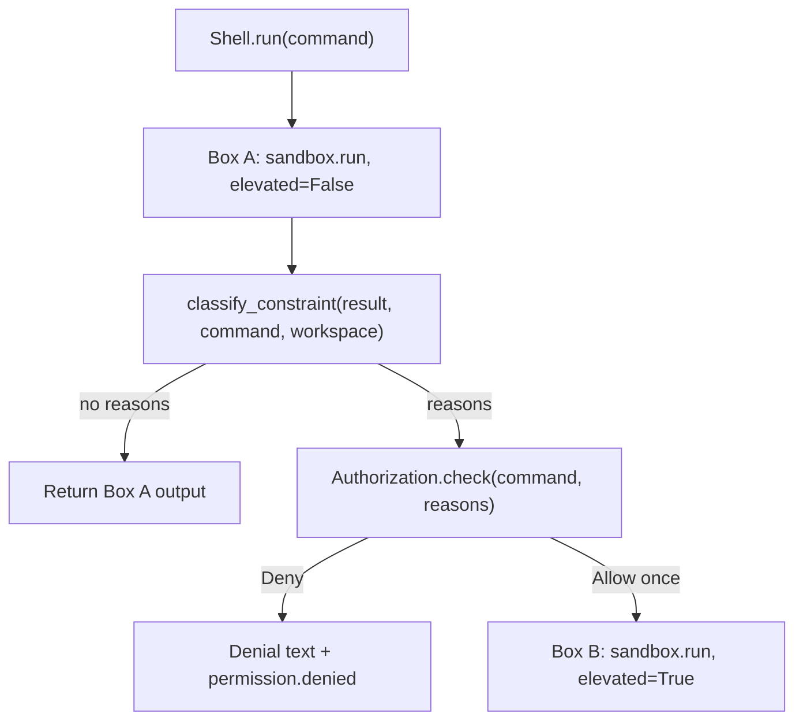

# Authorization and sandbox

How the agent bounds what tools can do, and where those bounds leak.

## Summary

| Capability | Boundary | Prompt |
| --- | --- | --- |
| `read_file`, `write_file` | Workspace path check | Never |
| `run_command` (Box A) | bubblewrap: workspace bind, no network | Never |
| `run_command` (Box B) | None: host process, network on | Every time, allow once |
| `web_search` | Runs in the harness process | Every query, allow once |
| Hooks | None: user's environment | Never |
| MCP tools | None: host authority | Never |

Authorization never matches command strings to decide policy. It reads the
**result** of a sandboxed run and asks the user when that run was blocked.

## Box A: the default sandbox

`BwrapSandbox.run(command, elevated=False)` runs `bash -c <command>` under
bubblewrap with:

- `--unshare-net` (no network) and `--die-with-parent`;
- read-only binds of `/usr`, `/bin`, `/lib`, `/lib64`, `/etc` (when present),
  so bash and common tools work;
- fresh `/proc`, `/dev`, and a tmpfs `/tmp`;
- a read-write bind of the workspace, used as the working directory.

If `bwrap` is not installed the run fails with exit code 127 and a clear
error. Every run has a 30-second timeout.

## Box B: elevation

The same command, run with `elevated=True`: plain `bash -c` on the host,
starting in the workspace but free to leave it, with network access.

Box B is always **allow once**. The decision is never stored, so the next
blocked command prompts again.

## The elevation flow

`classify_constraint` returns the reasons Box A blocked the command, or none:

- Exit code 0 never elevates.
- **network**: stdout/stderr contains a resolver or connection failure marker
  (`could not resolve host`, `network is unreachable`, `ENETUNREACH`, ...).
- **filesystem: \<paths\>**: the command or its output names a path outside
  the workspace (ignoring URLs and system prefixes such as `/usr`, `/etc`,
  `/tmp`, `/proc`), *and* the output contains a filesystem error marker (`no
  such file or directory`, `permission denied`, `read-only file system`, ...).

`Authorization.check` calls its protocol with action `elevate` and
`{"command", "reasons"}`, and returns true only for `ALLOW_ONCE`. The prompt
shows the command (truncated at 200 characters) and the reasons, not a raw dump
of tool arguments. The default selection is Deny.

On Deny, `Shell` emits `permission.denied` with `name: "run_command"` and the
reasons, and returns a message telling the model the command was not retried.
On Allow, the Box B output is returned with an `elevated (<reasons>)` header.

## Web search consent

`web_search` does not go through `Authorization` or the shell. `main.py`
gives it its own `PromptAuthorizationProtocol`, backed by
`Session.ask_web_search`, which is called with action `web_search` and
`{"query"}`. Every query prompts; Deny emits `permission.denied` with
`name: "web_search"` and the query. See [tools.md](tools.md#web-search).

## Seams

- `AuthorizationProtocol.check(action, args) -> DecisionType` is the consent
  interface. `DecisionType` is `ALLOW_ONCE` or `DENY`.
- `PromptAuthorizationProtocol` adapts a blocking `ask(action, args)` callable
  (the terminal panels in `Session`) by running it in a thread.
- `CommandSandbox.run(command, *, elevated) -> SandboxResult` is the sandbox
  interface. Tests inject a fake instead of running `bwrap`.
- `classify_constraint`, `outside_paths`, and `format_output` are pure
  functions.

## Composition hole

Each lock is honest in isolation. Together they leak. These are known
properties of the design, not bugs to patch with command matching.

1. **Context exfiltration.** Box A or `read_file` can put workspace secrets
   (`.env`) into the transcript. After a later elevation, Box B has network
   and can send that text anywhere. The sandbox never opened the secret
   again; the chat already had it.
2. **Missed elevation.** `python steal.py` may touch `~/.ssh` inside the
   script. Box A fails with ENOENT, but elevation only triggers when the
   output or command names an outside path *and* looks like a filesystem
   block. A script that fails opaquely is not retried in Box B. Conversely, a
   test failure that prints `/home/me/.ssh` can prompt for no reason.
3. **Allow once means the whole machine for that command.** Box B has no
   workspace bind and full network. One approved `python app.py` can read the
   home directory and talk to the internet. The command is not parsed to
   shrink Box B.
4. **System mounts in Box A.** `/usr`, `/etc`, and friends are readable so
   bash works. `cat /etc/passwd` does not leave the bind and does not elevate.
5. **MCP and hooks** bypass both boxes.

The lesson: boxes bound processes, not the transcript, and elevation is a
coarse capability.
